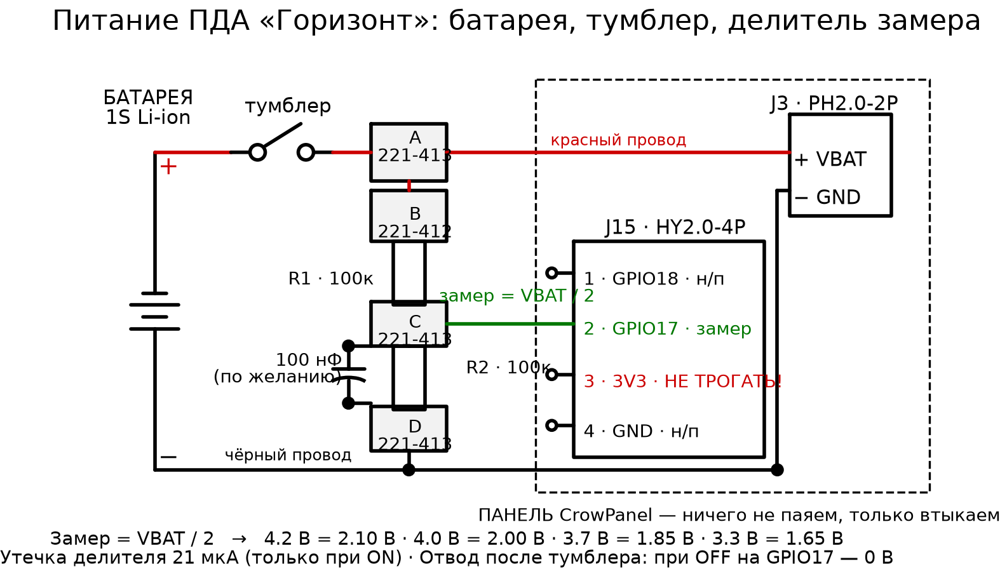

# Цепь питания ПДА «Горизонт» (CrowPanel Advance 3.5)

Основано на заводской схеме Elecrow `ESP32 Display 3.5 inch V1.4.sch`
(зарядник TP4059 = U2, мосфет развязки AO3401 = Q3, буст RY3420 = U3).
Панель НЕ паяется — только внешние провода и модули в штатные разъёмы.

## Принцип

- Батарея идёт **напрямую в J3 (BAT)**, заряжает её **штатный TP4059**
  током ~430 мА (PROG 2 кОм по схеме, таблица даташита) от любого USB-C
  панели. Внешний TP4056 **не нужен**.
- Версии платы V1.2/V1.3/V1.4 по питанию и пинам одинаковы (по вики
  менялись только усилитель и кнопки) — документ верен для всех них.
- Тумблер ставится **в разрыв красного (плюсового) провода** батареи.
  Чёрный провод — целый, напрямую.
- При воткнутом USB панель **всегда включена** (питание идёт через диоды
  напрямую, выключателя питания на плате нет). Тумблер = «батарея в цепи»,
  а не «ПДА выключен». Полное обесточивание = тумблер OFF **и** USB вынут.

## Поведение тумблера

| Тумблер | USB | Результат |
|---|---|---|
| ON | вынут | Работа от батареи |
| ON | воткнут | Работа от USB + батарея заряжается (правильный CC/CV с отсечкой) |
| OFF | вынут | Полный ноль, утечки из батареи нет |
| OFF | воткнут | Работа от USB, батарея НЕ заряжается (отключена) |

Заряд идёт **только при включённом тумблере** — это правильно.
Полный заряд 2500 мАч занимает ~6.5–7 ч.
В состоянии «USB воткнут, тумблер OFF» светодиоды заряда могут мигать —
это норма (зарядник без батареи), не неисправность.

## Схема подключения

*(исходник картинки — `power-divider.py` рядом: `python3 docs/power-divider.py`)*

- Делитель 100к+100к (индикация на экране) — опционально, см. ниже.
  Но если замер подключать вообще — только через делитель: батарею
  напрямую в GPIO нельзя (4.2 В выше абсолютного максимума пина 3.6 В
  и диапазона АЦП ~3.3 В — пин сгорит, читаться будет мусор).
  Отвод берётся со стороны J3 (после тумблера): при OFF прошивка увидит
  0 В = «батарея отключена». Утечка делителя 21 мкА.
- Разъём J15 (HY2.0-4P): pin 1 = GPIO18, **pin 2 = GPIO17**,
  pin 3 = 3V3, pin 4 = GND. Для делителя нужен только pin 2 (замер).
- Земля делителя берётся с чёрного провода батареи (это та же GND,
  что на J3) — так на панель идёт всего один провод.
- GND перед подключением проверить прозвонкой на корпус USB-C.

## Сборка делителя по шагам (панель не паяем)

Идея: два одинаковых резистора 100к соединяются «лесенкой» между плюсом
батареи и землёй и делят напряжение ровно пополам: 4.2 В батареи
превращаются в безопасные 2.1 В. Средняя точка лесенки идёт на замер
в J15. Из 4 проводов J15 нужен **только 1**: pin 2 (замер).
Земля берётся с чёрного провода батареи.

Что нужно: 2 резистора 100 кОм, кабель HY2.0-4P, Wago 221-412 ×1
(плюс по желанию керамический конденсатор 100 нФ — сгладить замер, см. шаг 7а),
и 221-413 ×3 (один 413-й ставится на красный провод вместо клеммы
тумблера, второй — на разрезанный чёрный провод), мультиметр,
изолента/термоусадка.

1. Воткнуть белый разъём кабеля в J15 на панели (входит только одной
   стороной, до щелчка защёлки).
2. Найти на плате метку пина 1 у J15 (треугольник / «1» / квадратная
   площадка). Разложить 4 свободных провода веером в том же порядке,
   как они входят в белый корпус: первый от метки = pin 1, далее 2, 3, 4.
3. Проверить мультиметром в режиме прозвонки: провод pin 4 должен
   звониться на металлический корпус USB-C (это GND). Не звонится —
   значит посчитали не с того конца, перевернуть нумерацию.
4. Пометить нужный провод кусочком изоленты: pin 2 = «замер».
5. Ненужные (pin 1, pin 3, pin 4) укоротить до ~1 см и заизолировать КАЖДЫЙ
   отдельно изолентой/термоусадкой. На pin 3 может быть 3.3 В —
   он не должен ничего касаться!
6. У резисторов укоротить выводы до ~10 мм. Резистор неполярный —
   какой стороной ставить, безразлично.
7. Собрать цепочку на Wago (см. схему выше):
   - клемма A (221-413): провод от тумблера + провод к J3 + отвод
     к делителю (ставится на красный провод между тумблером и J3);
   - клемма B (221-412): отвод + верхний вывод первого резистора;
   - клемма C (221-413): нижний вывод первого + верхний вывод второго
     + провод «замер» (pin 2);
   - клемма D (221-413): нижний вывод второго + чёрный провод
     со стороны батареи + чёрный провод к J3 (чёрный провод разрезается).
   Каждый провод после защёлкивания дёрнуть — не должен выходить.
7а. По желанию: керамика 100 нФ параллельно нижнему резистору (выводы
   конденсатора скрутить с выводами R2 и вставить в те же гнёзда Wago —
   лишних клемм не надо). Без него тоже работает (прошивка усредняет),
   но с ним показания стабильнее.
8. Проверка (батарея подключена, тумблер ON): напряжение между «замер»
   и чёрным проводом (GND) должно быть РОВНО ПОЛОВИНА напряжения батареи:

   | Батарея | Замер (pin 2) |
   |---|---|
   | 4.2 В | 2.10 В |
   | 4.0 В | 2.00 В |
   | 3.7 В | 1.85 В |
   | 3.5 В | 1.75 В |
   | 3.3 В | 1.65 В |

   Сошлось — собрано верно, можно включать. Дальше дело за прошивкой 1.7.0 (в 1.6.x замера ещё нет).

### Временный вариант: один контакт вместо кабеля HY2.0

Если кабеля нет, а собрать хочется сейчас: на J15 идёт всего один провод
(pin 2), его можно подключить одиночным гнездом DuPont **без пластикового
корпуса** (с корпусом в колодец разъёма не влезет — шаг 2.0 мм против
2.54). Голый контакт как правило входит внатяг; сажать аккуратно,
пины не гнуть. Контакт сядет немного свободно (пины 0.5 мм против 0.64
под DuPont) — после посадки зафиксировать каплей термоклея и убедиться,
что соседний pin 3 (3.3 В) ничего не касается. Перед включением
прозвонить: «замер» не должен звониться ни на 3V3, ни на GND.
Ориентацию ряда проверять так же прозвонкой: pin 4 звонится на корпус
USB-C (шаги 2–3 выше); попасть на pin 1 вместо pin 2 не страшно —
прошивка 1.7.0 сама найдёт делитель, а вот на pin 3 (3V3) попадать нельзя.

Это времянка для стенда: в носимом устройстве одиночный контакт
растрясётся. Для постоянной сборки закажите нормальный кабель HY2.0-4P
(позиция 8). Двухпиновый PH-кабель от батареи НЕ подойдёт: встанет
в 4-пиновый колодец со сдвигом и попадёт не на те пины.

## Проверка полярности J3 (обязательно, один раз!)

Разные батареи с PH2.0 бывают с разной полярностью. Не верьте цветам:

1. Воткнуть USB в панель, батарею НЕ подключать.
2. Мультиметр на 20 В DC, чёрный щуп на корпус USB-C.
3. Красным щупом по очереди на оба контакта J3: где **~3–4 В**
   (может слегка плавать — нормально) — там «+», где 0 — GND.
4. Красный провод батареи — на «+». Если не сходится — иголкой поднять
   фиксатор в белом корпусе PH2.0 и поменять провода местами (без пайки).

## Список запчастей

### Обязательное

| № | Что | Требования | Поисковая фраза |
|---|---|---|---|
| 1 | Аккумулятор Li-ion/Li-po 3.7 В, 2500–3000 мАч | **Со встроенной платой защиты (PCM)** — обязательно! Плоский пакет (напр. 103450) или 18650 с защитой + холдер. Желательно сразу с разъёмом PH2.0 | `3.7V lipo PCM PH2.0`, `103450 battery protection` |
| 2 | Тумблер движковый | SS12F15 или мини SS12F23, SPDT (используем как SPST), ток ≥ 0.5 А | `SS12F15 slide switch` |
| 3 | Кабель-удлинитель PH2.0-2P «папа-мама», 20–30 см | Режется пополам: батарея→тумблер и тумблер→J3 | `PH2.0-2P extension cable`, `JST PH 2.0 extension` |
| 4 | Блок питания 5 В / 2 А + кабель USB-C | С запасом: система ~0.5 А + заряд 0.43 А | — |
| 5 | Мультиметр | Любой дешёвый, для проверки полярности | `DT-830B` |

### Сборка без пайки

| № | Что | Зачем |
|---|---|---|
| 6 | Клеммы Wago 221-412 ×1, 221-413 ×3 | Соединение проводов вместо пайки (тумблер + делитель, см. схему выше). Без делителя хватит 2× 221-412 |

Компактная альтернатива: спаять всё навесом + термоусадка (5 минут
с паяльником, в разы меньше по объёму, чем Wago).

### Индикация заряда на экране (опционально)

| № | Что | Зачем |
|---|---|---|
| 7 | Резисторы 100 кОм ×2, 0.125/0.25 Вт, лучше 1% | Делитель VBAT/2 на GPIO17 (на каждом рассеивается 44 мкВт — подойдёт любая мощность) |
| 8 | Кабель HY2.0-4P с проводами, 20–30 см | Втыкается в свободный J15; нужен 1 провод (pin 2, замер), остальные изолировать. Поиск: `JST PH 2.0 4P wire cable`, `HY2.0-4P cable` |
| 9 | Прошивка 1.7.0 | Замер АЦП + иконка батареи с процентами. Пишется после готовности железа; для калибровки нужен один замер батареи мультиметром |

Прошивка 1.7.0 сама определит, на какой пин (GPIO17 или GPIO18) пришёл
делитель, — перепутать провода при сборке не страшно.

### Опционально / безопасность

- PTC-предохранитель 1 А (MF-MSMF010) в разрыв плюса — вторая линия
  защиты от КЗ поверх PCM батареи.
- Если батарея досталась БЕЗ платы защиты — модуль PCM 1S (DW01+MOSFET)
  в разрыв обязателен. Но проще сразу купить батарею с защитой (п. 1).

## Какой USB-C выводить наружу в корпусе

На плате два USB-C, заряжают они **одинаково** (оба через диоды идут
на зарядник и систему, на обоих есть CC-резисторы 5.1 кОм):

| Порт | Роль | Наружу? |
|---|---|---|
| J1 = USB0 (мост CH340) | Прошивка, консоль/логи, питание, зарядка | **Да, обязательно** — без него прошивку (напр. будущую 1.7.0) без разбора корпуса не обновить |
| J2 = USB1 (нативный USB/OTG) | Только питание и зарядка (прошивка ПДА нативный USB никак не использует) | По желанию, как запасной для зарядки |

Как отличить: на шелкографии нижний порт (ближе к краю платы
с разъёмами) подписан USB0/UART0 — это J1, его и выводим. Верхний
подписан USB1/OTG — это J2. Запасной способ: воткнуть каждый порт
USB-кабелем в компьютер — тот, который появится в системе как COM-порт
(USB-SERIAL CH340), и есть J1. Второй никак не проявится — это нормально.

## Чего НЕ делать

- Не ставить внешний TP4056 между батареей и J3: при включённом ПДА
  зарядник не увидит отсечку (ток системы маскирует конец заряда),
  батарея будет вечно висеть на 4.2 В. Штатный тракт панели этой
  проблемы не имеет (мосфет Q3 отключает батарею от системы на время
  заряда от USB).
- Не подключать ВТОРОЙ источник питания на пин 3 разъёма J10: это общая
  5-В шина (по вики — штатный вход питания платы), второй БП устроит
  конфликт источников. Питание внешнего радиомодуля ОТ этого пина —
  штатное использование standalone-вкуса (сейчас J10 свободен);
  плагин SX1262 питается со слота J9 (3V3 + IOT_5V).
- Не перепутать BAT и SPK: два одинаковых белых PH2.0-2P стоят рядом —
  смотрите шелкографию. Батарея в SPK / динамик в BAT = повреждение.
- Только батарея 1S (3.7 В, максимум 4.2 В). 2S (7.4 В) и выше — нельзя.
- Не использовать батарею без PCM: буст высосет её в ноль и убьёт.
